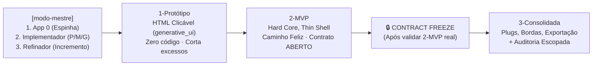

# App_base — Kit Base de Vibecoding Estruturado (v2.0)

Template oficial para criação e evolução assistida de aplicativos modulares com IA (**Espinha Mestre + Plugs + Funil Progressivo**), combinando prototipação rápida pré-código (`1-Protótipo`), entregas enxutas validadas na prática (`2-MVP`), `CONTRACT FREEZE` no momento certo, paralelismo sem colisão e arquivos abaixo de **250 linhas**.

---

## Como Iniciar um Novo Projeto a partir deste Template

1. Clique em **`Use this template`** $\rightarrow$ **`Create a new repository`** no GitHub (ou clone este repositório).
2. Abra o projeto no seu editor com IA e dispare o **`App 0`** no Chat 01:

```text
Ativar [modo-mestre]. Quero iniciar o App 0 para criar "[NOME DO APP]". A dor central que ele resolve é [descreva em 2 linhas].
```

---

## O Ciclo v2.0: 3 Perfis do `[modo-mestre]` + Funil Progressivo



| Perfil do `[modo-mestre]` | Quando Usar | Comportamento |
| :--- | :--- | :--- |
| **1. `App 0`** *(Fundador da Espinha)* | Repositório novo (sem `src/`). | Entrevista de Espinha (`6–8` perguntas) $\rightarrow$ `1-Protótipo` da casca + 1º fluxo $\rightarrow$ Espinha Mestre compilável (`contracts/`, `Result<T>`, `AppShell` + Snapshot JSON, `schemaVersion`) + 1º fluxo em `2-MVP`. |
| **2. `Implementador`** *(Plug `P / M / G`)* | Espinha pronta; criar nova ferramenta/módulo. | Entrevista Navalha (`3–4` perguntas) $\rightarrow$ `1-Protótipo` $\rightarrow$ `docs/planos/ativos/PLANO_[SLUG].md` (`L1–L25`) $\rightarrow$ `2-MVP` $\rightarrow$ `🔒 Freeze` $\rightarrow$ `3-Consolidada`. |
| **3. `Refinador`** *(Evolução Pontual)* | Melhorar ou acrescentar função em plug/espinha existente. | Leitura cirúrgica + mini-protótipo *condicional* $\rightarrow$ evolui o mesmo plano sem duplicar, garantindo `.optional().default(...)` e `< 250` LOC. |
| **`[modo-hotfix]`** *(Bugfix Puro)* | Corrigir defeito sem escopo novo. | **Teto rígido de 5 tool calls**, zero planejamento, correção cirúrgica + micro-scan. |

---

## Estrutura do Kit Base v2.0

```text
📁 App_base/
├── AGENTS.md                        # Constituição v2.0: Lazy Docs, 5 Regras Pétreas, 7 Posturas e Blindagens
├── STATE.md                         # Índice Enxuto da Espinha & Frentes Ativas (<= 45 linhas)
├── 📁 .agents/skills/               # 9 Personas Especialistas + Scanner Determinístico v3 (-TargetPaths)
│   ├── modo-mestre/                 # Arquiteto & Líder (3 Perfis: App 0 | Implementador P/M/G | Refinador)
│   ├── modo-prototipo/              # Prototipador HTML clicável avulso (generative_ui, zero código no repo)
│   ├── modo-hotfix/                 # Cirurgião de bugs (teto rígido de 5 tool calls)
│   ├── modo-dados/                  # Contratos, Persistência (schemaVersion), Oráculo CSV e Snapshot JSON
│   ├── modo-backend/                # Cérebro Puro (< 250 LOC) + Runner verify-oracle
│   ├── modo-fluxos/                 # Jornadas, Máquinas de Estado e Recuperação de Erros
│   ├── modo-uiux/                   # DNA Visual (12 Pilares + CAD 2D/3D), generative_ui e StitchMCP opcional
│   ├── modo-frontend/               # Telas modulares (< 250 LOC) conectadas via Fachadas (Result<T>)
│   └── modo-auditor/                # Auditoria Escopada em 4 Fases + scripts/scan-vibecode.ps1 (v3)
└── 📁 docs/                         # Hub Documental, Planos Isolados e Auditorias
    ├── 00-MANUAL-DEV.md             # Manual Rápido, Catálogo de Personas e Prompts Prontos
    ├── 01-GUIDELINES-VIBECODE.md    # Hard Cap 250 LOC, Caixa-Preta/Fachada, Result<T> e Retrocompatibilidade
    ├── 02-ARQUITETURA-FLUXOS.md     # Stack Lock, Espinha Mestre, Backlog de Plugs e Micro-ADRs
    ├── 03-CONTRATOS-DADOS.md        # Contratos Globais da Espinha, Result<T>, Snapshot JSON e Oráculo
    ├── 04-PADRAO-UIUX.md            # 12 Pilares Visuais, 7 Regras Sênior e 4 Diretrizes Prova de Fogo
    ├── 05-HOMOLOGACAO-BENCHMARK.md  # Homologação Final, Benchmark e Retroalimentação (/learn)
    ├── DESIGN.md                    # Tokens Visuais (85/12/3) para generative_ui e StitchMCP
    ├── golden-oracle.csv            # Planilha-Oráculo para validação matemática determinística
    ├── planos/                      # Planos isolados (TEMPLATE-PLANO.md, ativos/ e concluidos/)
    ├── audits/                      # Template e dossiês isolados (AUDIT_[SLUG].md)
    ├── referencias_tecnicas/        # Insumos técnicos e normas do domínio
    └── ui-templates/                # Gabaritos opcionais consolidados via Stitch
```

Consulte [`docs/00-MANUAL-DEV.md`](./docs/00-MANUAL-DEV.md) para os prompts prontos de cada etapa.
