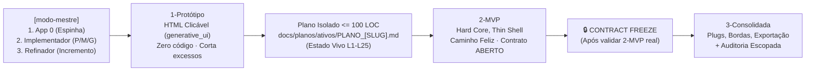

# 00-MANUAL-DEV.md — Manual Rápido, Personas & Prompts Prontos (v2.0)

Bem-vindo ao **Hub Central da Metodologia v2.0** (*Espinha Mestre + Funil `1-Protótipo → 2-MVP → 🔒 Freeze → 3-Consolidada` + Frentes Paralelas*).

---

## 1. Visão Geral do Aplicativo *(Preenchido pelo `[modo-mestre]` no `App 0`)*

- **Nome do App:** `{{PREENCHER_NO_APP_0: Nome do Aplicativo}}`
- **Dor Central:** `{{PREENCHER_NO_APP_0: O que o app resolve em 1 parágrafo curto}}`
- **Fluxo Vital do 1º `2-MVP` (Entrada $\rightarrow$ Processamento $\rightarrow$ Saída):**
  1. **Entrada:** `{{PREENCHER_NO_APP_0}}`
  2. **Núcleo / Regras:** `{{PREENCHER_NO_APP_0}}`
  3. **Saída / Visualização:** `{{PREENCHER_NO_APP_0}}`

---

## 2. O Ciclo Progressivo v2.0 & Os 3 Perfis do `[modo-mestre]`



### Classificação por Porte (`P / M / G`) no Perfil `Implementador`
- **`Porte P` (`< 150` LOC — micro-ferramenta ou ajuste enxuto):** `Entrevista curta` $\rightarrow$ `1-Protótipo` (se visual) $\rightarrow$ **implementação direta em 1 turno** + `scan-vibecode.ps1 -TargetPaths`.
- **`Porte M` (Padrão — nova ferramenta/módulo):** `1-Protótipo` $\rightarrow$ `PLANO_[SLUG].md` $\rightarrow$ `2-MVP` (*Step-Budget* 1 camada/turno) $\rightarrow$ `🔒 Freeze` $\rightarrow$ `3-Consolidada`.
- **`Porte G` (Subsistema complexo):** Mesmo funil, fatiado em **chats isolados *Bottom-Up*** (`[modo-dados]` $\rightarrow$ `[modo-backend]` $\rightarrow$ `[modo-fluxos]` $\rightarrow$ `[modo-frontend]`).

---

## 3. Catálogo de Personas (`[modo-xx]`)

| Comando | Skill | Quando Usar | Limite Rígido |
| :--- | :--- | :--- | :--- |
| **`[modo-mestre]`** | [`.agents/skills/modo-mestre/SKILL.md`](../.agents/skills/modo-mestre/SKILL.md) | **3 Perfis auto-detectados:** `App 0` (fundar Espinha), `Implementador` (novo plug `P/M/G`) e `Refinador` (evolução pontual em plug/espinha existente). | **Zero código** antes do `1-Protótipo` aprovado; zero campos especulativos de V2/V3. |
| **`[modo-prototipo]`** | [`.agents/skills/modo-prototipo/SKILL.md`](../.agents/skills/modo-prototipo/SKILL.md) | Testar ideia visual solta ou comparar 2 layouts clicáveis em 1 turno (`generative_ui`), sem abrir plano. | **Zero edição** no repositório (`src/`, `docs/`). |
| **`[modo-hotfix]`** | [`.agents/skills/modo-hotfix/SKILL.md`](../.agents/skills/modo-hotfix/SKILL.md) | Bugfix puro, typo, cor ou fórmula errada **sem escopo novo**. | **Teto rígido de 5 tool calls**; sem mudança de contrato. |
| **`[modo-dados]`** | [`.agents/skills/modo-dados/SKILL.md`](../.agents/skills/modo-dados/SKILL.md) | `src/contracts/` (`Result<T>`), I/O Read-Only, `schemaVersion`, `golden-oracle.csv` e Snapshot JSON. | Respeita `🔒 Freeze` (`.optional().default(...)`). |
| **`[modo-backend]`** | [`.agents/skills/modo-backend/SKILL.md`](../.agents/skills/modo-backend/SKILL.md) | Cérebro Puro (`src/core/`, `< 250` LOC) + runner executável `scripts/verify-oracle.*`. | Zero DOM, rede, storage ou validação "de cabeça". |
| **`[modo-fluxos]`** | [`.agents/skills/modo-fluxos/SKILL.md`](../.agents/skills/modo-fluxos/SKILL.md) | Máquinas de estado, travas de duplo clique e recuperação de falhas. | Zero regra visual; `< 250` LOC. |
| **`[modo-uiux]`** | [`.agents/skills/modo-uiux/SKILL.md`](../.agents/skills/modo-uiux/SKILL.md) | `docs/DESIGN.md`, ergonomia `generative_ui`, `src/ui/design-system/` e `StitchMCP` opcional. | Obediência estrita aos 12 Pilares + CAD 2D/3D sob demanda. |
| **`[modo-frontend]`** | [`.agents/skills/modo-frontend/SKILL.md`](../.agents/skills/modo-frontend/SKILL.md) | Telas modulares (`src/ui/pages/`, `< 250` LOC) fiéis ao `1-Protótipo` aprovado via Fachadas. | Zero `<aside>` fora do `AppShell`, zero I/O ou cálculo na view. |
| **`[modo-auditor]`** | [`.agents/skills/modo-auditor/SKILL.md`](../.agents/skills/modo-auditor/SKILL.md) | Auditoria escopada em 4 Fases (`scan-vibecode.ps1 -TargetPaths`) $\rightarrow$ `docs/audits/AUDIT_[SLUG].md`. | **100% Read-Only** nas Fases 1–3; obriga Gate de Economia. |

### Especialistas Extras Criados para Este App *(se houver)*
- `{{OPCIONAL_NO_APP_0: ex. [modo-motor-financeiro] -> .agents/skills/modo-motor-financeiro/SKILL.md}}`

---

## 4. Ferramentas de Apoio Determinístico

| Necessidade | Ferramenta Oficial | Uso |
| :--- | :--- | :--- |
| **Prototipação Imediata** | **`generative_ui` + `docs/DESIGN.md`** | Padrão do `1-Protótipo` (clicável em 1 turno no chat). *StitchMCP é opcional sob demanda no `App 0`.* |
| **Esboço de Fluxos** | **https://www.tldraw.com/** · **https://app.diagrams.net/** | Opcional para rabiscar fluxos complexos e colar print no chat. |
| **Prova Matemática Exata** | **`docs/golden-oracle.csv` + `scripts/verify-oracle.*`** | Confronto automático no terminal (`0 divergências`) — proibido conferir contas no olho. |
| **Reprodução de Bugs** | **Botão Snapshot de Diagnóstico JSON** (`AppShell`) | Baixa/restaura `{ schemaVersion, appState, recentLogs }` em 1 clique. |
| **Micro-Scan Paralelo** | **[`scan-vibecode.ps1`](../.agents/skills/modo-auditor/scripts/scan-vibecode.ps1) (v3)** | Sempre com `-TargetPaths <frente>` e `-PlanFile <plano>`: checa `250` LOC, `catch` vazio, Fachadas, pureza, Freeze e DNA Visual. |

---

## 5. Prompts Prontos (Copiar e Colar)

### 1) Fundar Novo App (`[modo-mestre]` $\rightarrow$ Perfil `App 0`)
```text
Ativar [modo-mestre]. Quero iniciar o App 0 para criar "[NOME DO APP]". A dor central é [descreva em 2 linhas]. Conduza a entrevista de espinha e gere o 1-Protótipo clicável antes de qualquer código.
```

### 2) Criar Nova Ferramenta / Plug (`[modo-mestre]` $\rightarrow$ Perfil `Implementador P/M/G`)
```text
Ativar [modo-mestre]. Quero adicionar a ferramenta "[NOME]" sobre a espinha atual para resolver [dor única do Dia 1]. Faça a Entrevista Navalha (enquadrando Porte P/M/G) e gere o 1-Protótipo clicável.
```

### 3) Evoluir Ferramenta ou Espinha Existente (`[modo-mestre]` $\rightarrow$ Perfil `Refinador`)
```text
Ativar [modo-mestre] (Refinador). Na frente docs/planos/ativos/PLANO_[SLUG].md (ou [caminho]), quero acrescentar/refinar [descreva a melhoria]. Verifique a Memória Negativa, retrocompatibilidade (.optional().default) e < 250 LOC.
```

### 4) Executar `2-MVP` ou `3-Consolidada` de Uma Frente
```text
Ativar [modo-backend] (ou [modo-dados] / [modo-frontend]). Leia L1–L25 e a seção 2-MVP de docs/planos/ativos/PLANO_[SLUG].md e entregue apenas esta camada (Step-Budget), validando com scan-vibecode.ps1 -TargetPaths.
```

### 5) Auditar Frente Isolada (`[modo-auditor]`)
```text
Ativar [modo-auditor]. Execute a Fase 1 (scan-vibecode.ps1 -TargetPaths + Raio-X Leve) da frente docs/planos/ativos/PLANO_[SLUG].md e apresente as Lentes da Fase 2 antes de ler o restante do código.
```

### 6) Bugfix Cirúrgico (`[modo-hotfix]`)
```text
Ativar [modo-hotfix]. Em [caminho/do/arquivo], corrija diretamente [descreva o defeito] sem mudar escopo nem ler arquivos fora do alvo.
```
