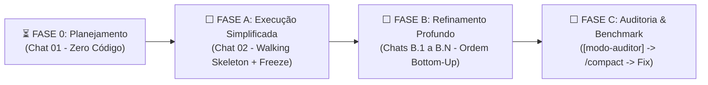

# 00-MANUAL-DEV.md — Instrutor Mestre & Roteador do Projeto

Bem-vindo ao **Manual do Desenvolvedor e Instrutor da IA**. Este documento é o **Hub Central** do projeto: ele explica de forma básica como o aplicativo funciona, como operar os modos especialistas (`[modo-xx]`), as ferramentas de apoio humano/determinístico e quais arquivos ler antes de cada atividade.

---

## 1. Como o Aplicativo Funciona (Visão Geral Básica)

> *Nota do Kit Base: Esta seção é preenchida pelo `[modo-arquiteto]` ao final da entrevista da Fase 0 (Regra 01).*

- **Nome do App:** `{{PREENCHER_NA_FASE_0: Nome do Aplicativo}}`
- **Objetivo Principal:** `{{PREENCHER_NA_FASE_0: Qual dor resolve em 1 parágrafo}}`
- **Fluxo Básico (Entrada $\rightarrow$ Processamento $\rightarrow$ Saída):**
  1. **Coleta/Entrada:** `{{PREENCHER_NA_FASE_0: De onde vêm os dados}}`
  2. **Processamento/Regras:** `{{PREENCHER_NA_FASE_0: O que o coração do app calcula ou transforma}}`
  3. **Visualização/Exportação:** `{{PREENCHER_NA_FASE_0: Como o usuário vê e para onde exporta os resultados}}`

---

## 2. Ciclo de Vida de Construção & Radar Visual Etapa a Etapa

### 2.1 Checklist Etapa a Etapa do Ciclo (Espelhado em `STATE.md`)
Em todas as fases, a IA atualiza e exibe o progresso usando os marcadores `✅ Concluído`, `⏳ ATUAL` e `⬜ Pendente`:

- **FASE 0 — Descoberta & Arquitetura (Chat 01 — Regra 01: Zero Código)**
  - `[ ] 0.1` Entrevista de Descoberta (`[modo-arquiteto]` + apoio tldraw/diagrams.net)
  - `[ ] 0.2` Criação física das Skills Especialistas extras em `.agents/skills/` (Regra 03)
  - `[ ] 0.3` Preenchimento de `docs/00` a `04`, `DESIGN.md` e estimativa preliminar de Chats da Fase B
- **FASE A — *Walking Skeleton* & *Contract Freeze* (Chat 02 — Chat Único)**
  - `[ ] A.1` Entrevista Tática Pré-Código (`[modo-arquiteto]`)
  - `[ ] A.2` Contratos, Planilha-Oráculo (`golden-oracle.csv`), Mocks e Snapshot JSON (`[modo-dados]`)
  - `[ ] A.3` Mapeamento de Fluxos e Guardas de Estado (`[modo-fluxos]`)
  - `[ ] A.4` Template Mestre no Stitch (`StitchMCP`), download em `docs/ui-templates/` e `design-system/` (`[modo-uiux]`)
  - `[ ] A.5` Esqueleto Funcional Core (`[modo-backend]`) + Telas Iniciais (`[modo-frontend]`)
  - `[ ] A.6` **Marco Final da Fase A:** Decreto de `🔒 CONTRACT FREEZE` + **Fechamento da Fila Ordenada de Chats da Fase B (`B.1 a B.N`)** + Checkpoint Git
- **FASE B — Refinamento Sênior em Chats Isolados (`Chats B.1 até B.N`)**
  - *A quantidade exata de chats (`N`) e a ordem de execução são travadas no passo `A.6` e listadas em `STATE.md` e `02-ARQUITETURA-FLUXOS.md`.*
- **FASE C — Auditoria Determinística & Homologação (Regra 05)**
  - `[ ] C.1` Execução do `scan-vibecode.ps1` + Auditoria por Lente (`[modo-auditor]`) $\rightarrow$ `docs/audits/AUDIT-ATUAL.md`
  - `[ ] C.2` Ciclo `/compact` $\rightarrow$ Correção cirúrgica pelo `[modo-especialista]`
  - `[ ] C.3` Homologação final e Benchmark em `docs/05-HOMOLOGACAO-BENCHMARK.md`

### 2.2 Regra de Abertura, Quantidade e Ordem de Execução na Fase B
Para que você saiba exatamente **quantos chats abrir** e **em qual sequência**, a Fase B segue a **Ordem *Bottom-Up* (da Fundação para a Casca Visual)**:

| Ordem Padrão | Especialidade / Escopo do Chat Isolado | Modo Ativo | Por que nesta ordem? (Dependência) |
| :---: | :--- | :--- | :--- |
| **1º (`Chat B.1`)** | **Camada de Dados, I/O & Persistência** (`src/data/`) | `[modo-dados]` | Garante que importação, parsers, storage e Snapshot JSON estejam blindados primeiro. |
| **2º (`Chat B.2..k`)** | **Módulos de Domínio / Cérebro Puro** (1 chat por módulo de `src/core/` ou skill extra) | `[modo-backend]` ou `[modo-extra]` | Reconcilia 100% dos cálculos com a Planilha-Oráculo (`golden-oracle.csv`) antes de ligar na tela. |
| **3º (`Chat B.k+1`)** | **Orquestração de Fluxos & State Machines** | `[modo-fluxos]` | Conecta Dados + Core com travas contra cliques duplos e recuperação de erro. |
| **4º (`Chat B.k+2`)** | **Design System & Novos Templates Stitch** (`docs/ui-templates/`) | `[modo-uiux]` | *(Paralelizável com 1º–3º, mas obrigatório antes do Frontend)* Garante todos os gabaritos prontos. |
| **5º (`Chat B.N`)** | **Refinamento de Páginas / Telas** (1 chat por página ou área em `src/ui/pages/`) | `[modo-frontend]` | Consome o Design System e as Fachadas já testadas, aplicando os 4 estados obrigatórios. |

---

## 3. Ferramentas de Apoio Humano & Determinístico (Onde a IA Precisa de Precisão Extra)

| Etapa / Necessidade | Ferramenta Oficial Integrada ao Kit | Como Utilizar |
| :--- | :--- | :--- |
| **Desenho e Correção de Fluxos / Entrevista** | **https://www.tldraw.com/** e **https://app.diagrams.net/** | No **início ou fim** das etapas de Entrevista (`[modo-arquiteto]`) e Fluxos (`[modo-fluxos]`), desenhe esboços ou rabisque correções visuais e cole o print no chat. |
| **Prototipação e Coerência de Telas (UI/UX)** | **`docs/DESIGN.md` $\leftrightarrow$ `StitchMCP`** | O `[modo-uiux]` envia o `DESIGN.md` ao Stitch, você ajusta lá, e o MCP baixa o gabarito consolidado para `docs/ui-templates/`. |
| **Validação Matemática 100% Exata** | **Planilha-Oráculo (`docs/golden-oracle.csv`)** | Monte no Excel/Sheets de 5 a 15 linhas com entradas e resultados esperados. O `[modo-backend]` valida o código até a diferença ser zero. |
| **Reprodução Instantânea de Bugs** | **Botão de Snapshot de Diagnóstico JSON** | Presente no `AppShell` do app: baixa o estado atual (`appState` + logs `[MÓDULO:FUNÇÃO]`) em JSON para anexar no chat quando ocorrer um erro. |
| **Auditoria de Linhas, Imports e `catch` Vazio** | **Scanner [`.agents/skills/modo-auditor/scripts/scan-vibecode.ps1`](../.agents/skills/modo-auditor/scripts/scan-vibecode.ps1)** | Executado automaticamente pelo `[modo-auditor]` para detectar arquivos > 250 linhas, imports proibidos e `catch` vazios em 1 segundo. |

---

## 4. Manual de Skills e Personas (`[modo-xx]`)

Para ativar uma persona, digite o comando **`[modo-nome]`** no chat:

### 4.1 Modos Base do Kit
| Comando | Skill Vinculada | Quando Utilizar |
| :--- | :--- | :--- |
| **`[modo-arquiteto]`** | [`.agents/skills/modo-arquiteto/SKILL.md`](../.agents/skills/modo-arquiteto/SKILL.md) | Entrevistas (Fase 0 e pré-Fase A com apoio de tldraw/diagrams.net), definição de pastas, criação física de novas Skills, *Stack Lock* e *Contract Freeze*. |
| **`[modo-dados]`** | [`.agents/skills/modo-dados/SKILL.md`](../.agents/skills/modo-dados/SKILL.md) | Definir onde colher dados, schemas, Planilha-Oráculo (`docs/golden-oracle.csv`), Snapshot de Diagnóstico JSON e exportação. |
| **`[modo-fluxos]`** | [`.agents/skills/modo-fluxos/SKILL.md`](../.agents/skills/modo-fluxos/SKILL.md) | Mapear e corrigir jornadas e máquinas de estado (com apoio visual no início/fim via tldraw e diagrams.net). |
| **`[modo-uiux]`** | [`.agents/skills/modo-uiux/SKILL.md`](../.agents/skills/modo-uiux/SKILL.md) | Gerar `docs/DESIGN.md`, operar o ciclo `StitchMCP` (Template Mestre e novas páginas), baixar gabaritos em `docs/ui-templates/` e extrair `src/ui/design-system/`. |
| **`[modo-backend]`** | [`.agents/skills/modo-backend/SKILL.md`](../.agents/skills/modo-backend/SKILL.md) | Implementar regras de negócio puras (< 250 linhas) reconciliadas com a Planilha-Oráculo (`docs/golden-oracle.csv`). |
| **`[modo-frontend]`** | [`.agents/skills/modo-frontend/SKILL.md`](../.agents/skills/modo-frontend/SKILL.md) | Construir telas modulares (< 250 linhas) a partir de `docs/ui-templates/` e `src/ui/design-system/`, conectadas às Fachadas. |
| **`[modo-auditor]`** | [`.agents/skills/modo-auditor/SKILL.md`](../.agents/skills/modo-auditor/SKILL.md) | Rodar `scan-vibecode.ps1`, inspecionar o app (**100% Read-Only no código**) e gerar o Dossiê de Correção pós-`/compact`. |

### 4.2 Modos Especialistas Criados para Este App
> *O `[modo-arquiteto]` listará abaixo todas as Skills extras criadas fisicamente em `.agents/skills/` antes da Fase A:*
- `{{PREENCHER_NA_FASE_0: ex. [modo-calculo-financeiro] -> .agents/skills/modo-calculo-financeiro/SKILL.md}}`

---

## 5. Tabela de Roteamento Obrigatório ("Vai fazer X? Leia o arquivo Y")

| Atividade / Modo Ativo | Arquivos de Leitura Obrigatória (*Pre-Flight*) | Arquivos que Pode Editar |
| :--- | :--- | :--- |
| **Iniciar qualquer chat** | [`AGENTS.md`](../AGENTS.md) + [`STATE.md`](../STATE.md) | [`STATE.md`](../STATE.md) (ao finalizar) |
| **Planejar / Arquitetar (`[modo-arquiteto]`)** | Todos em `docs/` | `docs/*` e `.agents/skills/*` |
| **Modelar Dados / I-O (`[modo-dados]`)** | [`01-GUIDELINES-VIBECODE.md`](./01-GUIDELINES-VIBECODE.md) + [`03-CONTRATOS-DADOS.md`](./03-CONTRATOS-DADOS.md) | `docs/03-CONTRATOS-DADOS.md`, `docs/golden-oracle.csv`, contratos, schemas, mocks e snapshot |
| **Mapear Fluxos (`[modo-fluxos]`)** | [`02-ARQUITETURA-FLUXOS.md`](./02-ARQUITETURA-FLUXOS.md) + [`03-CONTRATOS-DADOS.md`](./03-CONTRATOS-DADOS.md) | `docs/02-ARQUITETURA-FLUXOS.md`, orquestradores de estado/fluxo |
| **Design System & Stitch (`[modo-uiux]`)** | [`01-GUIDELINES-VIBECODE.md`](./01-GUIDELINES-VIBECODE.md) + [`04-PADRAO-UIUX.md`](./04-PADRAO-UIUX.md) + [`DESIGN.md`](./DESIGN.md) | `docs/DESIGN.md`, `docs/04-PADRAO-UIUX.md`, `docs/ui-templates/*`, `src/ui/design-system/*` |
| **Codar Core/Backend (`[modo-backend]`)** | [`01-GUIDELINES-VIBECODE.md`](./01-GUIDELINES-VIBECODE.md) + [`02-ARQUITETURA-FLUXOS.md`](./02-ARQUITETURA-FLUXOS.md) + [`03-CONTRATOS-DADOS.md`](./03-CONTRATOS-DADOS.md) + `docs/golden-oracle.csv` | Módulos de domínio, serviços, cálculos e persistência |
| **Codar Telas (`[modo-frontend]`)** | [`01-GUIDELINES-VIBECODE.md`](./01-GUIDELINES-VIBECODE.md) + [`03-CONTRATOS-DADOS.md`](./03-CONTRATOS-DADOS.md) + [`04-PADRAO-UIUX.md`](./04-PADRAO-UIUX.md) + `docs/ui-templates/*` | Páginas, views, hooks visuais e composição de telas |
| **Auditar (`[modo-auditor]`)** | Saída do `scan-vibecode.ps1` + Documento-régua da área + código-fonte | **APENAS** `docs/audits/AUDIT-ATUAL.md` e `STATE.md` (**Zero edição de código**) |

---

## 6. Como Reutilizar Este Kit Base em Novos Projetos

Para iniciar qualquer novo aplicativo do zero com esta metodologia:
1. Copie `AGENTS.md`, `STATE.md`, a pasta `.agents/skills/` (com os 7 modos base e o script `scan-vibecode.ps1`) e a pasta `docs/` para a raiz do novo projeto.
2. Abra o **Chat 01** no novo projeto e digite:
   > `Ativar [modo-arquiteto]. Vamos iniciar a Fase 0 (Regra 01) para um novo aplicativo.`
