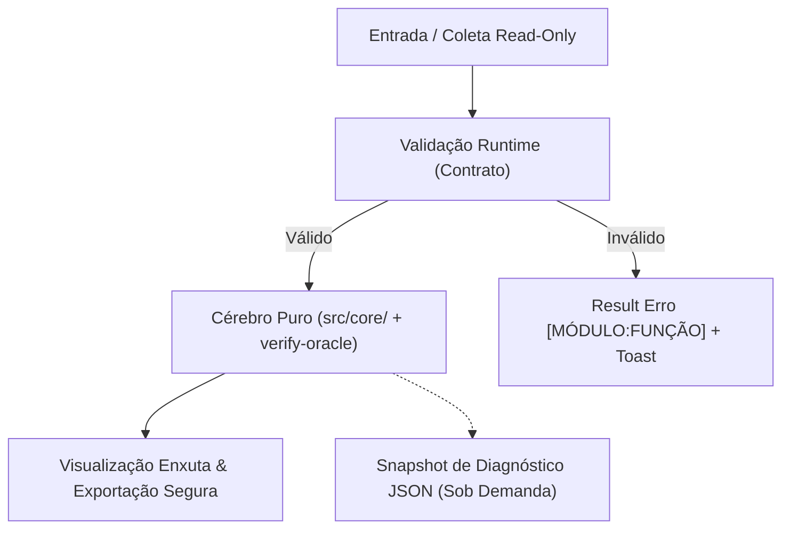

# 02-ARQUITETURA-FLUXOS.md — Espinha Mestre, Stack Lock & Backlog de Plugs (v2.0)

> *Responsáveis:* **`[modo-mestre]`** (Espinha, Stack Lock, Micro-ADRs e Backlog de Plugs) e **`[modo-fluxos]`** (Jornadas da Espinha).
> *Apoio Visual Opcional:* Para rabiscar fluxos complexos ou correções, use **https://www.tldraw.com/** ou **https://app.diagrams.net/** e cole o print no chat.

---

## 1. Stack Oficial Travada (*Stack Lock*)

> **REGRA:** Nenhuma biblioteca fora desta tabela pode ser instalada sem aprovação explícita do `[modo-mestre]`.

| Camada | Tecnologia / Pacote Oficial | Versão / Finalidade |
| :--- | :--- | :--- |
| **Linguagem / Runtime** | `{{PREENCHER_NO_APP_0}}` | `{{PREENCHER_NO_APP_0}}` |
| **Framework UI / App** | `{{PREENCHER_NO_APP_0}}` | `{{PREENCHER_NO_APP_0}}` |
| **Estilização / Componentes** | `{{PREENCHER_NO_APP_0}}` | `{{PREENCHER_NO_APP_0}}` |
| **Validação / Contratos** | `{{PREENCHER_NO_APP_0: ex. Zod / Pydantic}}` | `{{PREENCHER_NO_APP_0}}` |
| **Manipulação de Dados / I-O** | `{{PREENCHER_NO_APP_0}}` | `{{PREENCHER_NO_APP_0}}` |
| **Testes / Verificação** | `{{PREENCHER_NO_APP_0}}` | `{{PREENCHER_NO_APP_0}}` |

---

## 2. Árvore Viva da Espinha Mestre & Plugs (`< 250` LOC por Arquivo)

```text
📁 src/ (Espinha Mestre Padrão v2.0)
├── 📁 contracts/                # Tipos globais, Result<T>, AppError e schemas base
│   └── index.*                  # Fachada pública de contratos
├── 📁 core/                     # [Cérebro Puro] Regras determinísticas (zero DOM/rede/storage)
│   └── 📁 {{plug_1}}/
│       └── index.*              # Fachada pública do plug (retorna Result<T>)
├── 📁 data/                     # [I/O & Persistência] Leitura Read-Only, schemaVersion, Snapshot JSON
│   ├── 📁 mocks/                # Casos de teste (feliz + bordas)
│   ├── snapshot.*               # Exportar / Importar Snapshot de Diagnóstico JSON
│   └── index.*                  # Fachada pública de dados (retorna Result<T>)
└── 📁 ui/                       # [Casca Visual] Zero I/O direto (consome apenas Fachadas)
    ├── 📁 design-system/        # AppShell único (com Botão Snapshot) + componentes-base (<250 LOC)
    └── 📁 pages/                # Telas modulares por plug (<250 LOC por arquivo)
📁 scripts/
└── verify-oracle.*              # Runner executável contra docs/golden-oracle.csv (quando houver cálculo)
```

---

## 3. Mecanismo Padrão de Depuração: Botão de Snapshot de Diagnóstico JSON

Presente por padrão no `<AppShell>` da Espinha (`App 0`):
1. **Exportar Snapshot (`snapshot-YYYYMMDD-HHMM.json`):** Baixa `{ schemaVersion, exportedAt, currentViewOrStep, appState, recentLogs }`.
2. **Importar Snapshot:** Restaura imediatamente o estado do JSON para reprodução instantânea de bugs no chat.

---

## 4. Fluxo Principal da Espinha (`App 0`)



---

## 5. Backlog de Plugs Futuros & Mapa de Planos (`docs/planos/`)

> **Regra Anti-Inchaço do `App 0`:** Futuros plugs citados na concepção ficam apenas listados abaixo em 1 linha. Cada um só ganha `1-Protótipo` e `docs/planos/ativos/PLANO_[SLUG].md` quando você acionar `[modo-mestre]` (Perfil `Implementador`).

| Plug / Ferramenta | Porte Previsto (`P/M/G`) | Status | Plano Isolado |
| :--- | :---: | :---: | :--- |
| **Espinha + 1º Fluxo Vital (`App 0`)** | `M` | `⬜ Pendente` | `docs/planos/ativos/PLANO_APP0.md` |
| `{{plug_futuro_1}}` | `{{P/M/G}}` | `⬜ Backlog` | *(criar sob demanda)* |

---

## 6. Micro-ADRs & Checkpoints Git

| ID | Data/Marco | Decisão / Tag Git | Motivo / Restrição |
| :--- | :--- | :--- | :--- |
| **ADR-01** | Kit v2.0 | `1-Protótipo` (`generative_ui`) antes do código e `🔒 CONTRACT FREEZE` apenas pós-`2-MVP` validado. | Podar excessos antes de gastar código e evitar congelamento no escuro. |
| **ADR-02** | Kit v2.0 | Hard Cap `250` LOC, Fachadas (`Result<T>`), Planos isolados (`L1–L25`) e `scan -TargetPaths`. | Máxima precisão da IA e paralelismo sem colisão entre chats. |
| **ADR-03** | `{{App 0}}` | `{{PREENCHER_NO_APP_0}}` | `{{PREENCHER_NO_APP_0}}` |
