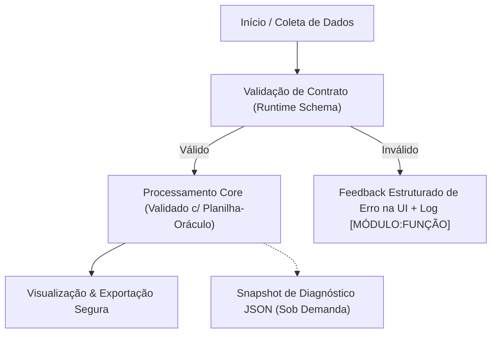

# 02-ARQUITETURA-FLUXOS.md — Mapa Modular, Stack Lock e Fluxos de Trabalho

> *Responsáveis por este documento:* **`[modo-arquiteto]`** (Topologia, Stack Lock e ADRs) e **`[modo-fluxos]`** (Jornadas e Máquinas de Estado).

> **DICA DE APOIO VISUAL (INÍCIO E FIM DE ENTREVISTAS/FLUXOS):**
> Sempre que quiser desenhar uma ideia inicial de arquitetura/fluxo ou rabiscar correções sobre o fluxo proposto pela IA, utilize:
> - **https://www.tldraw.com/** *(Quadro branco rápido para esboços livres e anotações visuais)*
> - **https://app.diagrams.net/** *(Diagramas de blocos e fluxogramas estruturados)*
> Basta colar o print ou arquivo no chat!

---

## 1. Stack Oficial Travada (*Stack Lock*)

> **REGRA:** Nenhuma biblioteca fora desta tabela pode ser instalada na Fase A ou Fase B sem aprovação explícita do `[modo-arquiteto]`.

| Camada | Tecnologia / Pacote Oficial | Versão / Finalidade |
| :--- | :--- | :--- |
| **Linguagem / Runtime** | `{{PREENCHER_NA_FASE_0}}` | `{{PREENCHER_NA_FASE_0}}` |
| **Framework UI / App** | `{{PREENCHER_NA_FASE_0}}` | `{{PREENCHER_NA_FASE_0}}` |
| **Estilização / Componentes** | `{{PREENCHER_NA_FASE_0}}` | `{{PREENCHER_NA_FASE_0}}` |
| **Validação / Contratos** | `{{PREENCHER_NA_FASE_0: ex. Zod / Pydantic}}` | `{{PREENCHER_NA_FASE_0}}` |
| **Manipulação de Dados / I-O** | `{{PREENCHER_NA_FASE_0}}` | `{{PREENCHER_NA_FASE_0}}` |
| **Testes / Verificação** | `{{PREENCHER_NA_FASE_0}}` | `{{PREENCHER_NA_FASE_0}}` |

---

## 2. Subdivisão de Personas para Este App (Regra 03)

Além dos 7 modos base do Kit, este aplicativo utiliza os seguintes especialistas criados fisicamente em `.agents/skills/`:

| Modo Especialista | Arquivo da Skill | Escopo e Responsabilidade Exclusiva |
| :--- | :--- | :--- |
| `{{PREENCHER_NA_FASE_0: ex. [modo-motor-financeiro]}}` | `.agents/skills/modo-.../SKILL.md` | `{{PREENCHER_NA_FASE_0}}` |

---

## 3. Árvore Viva de Diretórios e Fachadas (Living Directory Map)

> **REGRA DE SINCRONIA:** Todo arquivo deve ter `< 250 linhas`. Sempre que um módulo novo for criado, atualize esta árvore indicando sua **Responsabilidade Única** e sua **Fachada Pública**.

```text
📁 src/ (Estrutura Padrão do Kit Base)
├── 📁 contracts/                # [Imutável após Fase A] Tipos, interfaces e schemas globais
│   └── index.*                  # Fachada pública de contratos
├── 📁 core/                     # [Cérebro Puro] Regras de negócio e cálculos (validados contra docs/golden-oracle.csv)
│   └── 📁 {{modulo_1}}/
│       └── index.*              # Fachada pública do módulo
├── 📁 data/                     # [I/O & Persistência] Coleta, storage (com schemaVersion), exportação e Snapshot
│   ├── 📁 mocks/                # Golden Dataset (casos normais e de borda)
│   ├── snapshot.*               # Rotina padrão de Exportar/Importar Snapshot de Diagnóstico JSON
│   └── index.*                  # Fachada pública de dados
└── 📁 ui/                       # [Casca Visual]
    ├── 📁 design-system/        # Componentes-base extraídos do Template Mestre do Stitch (inclui Botão de Snapshot no AppShell)
    └── 📁 pages/                # Telas modulares (<250 linhas) derivadas de docs/ui-templates/
```

---

## 4. Mecanismo Padrão de Depuração: Botão de Snapshot de Diagnóstico JSON

Todo aplicativo gerado por este Kit Base inclui por padrão no `AppShell` (rodapé ou menu de utilidades) um controle discreto de **Snapshot de Diagnóstico**:
1. **Exportar Snapshot (`snapshot-YYYYMMDD-HHMM.json`):** Baixa um JSON contendo `{ schemaVersion, timestamp, currentRoute, appState, recentErrors }`.
2. **Importar Snapshot:** Restaura imediatamente o estado do arquivo JSON na memória do app.
3. **Uso com a IA:** Se o usuário encontrar qualquer comportamento estranho ou erro visual/matemático, basta clicar em **Exportar Snapshot**, anexar o JSON no chat e a IA reproduzirá o estado exato em segundos.

---

## 5. Fluxos de Trabalho e Máquinas de Estado (`[modo-fluxos]`)

### 5.1 Diagrama de Fluxo Principal


### 5.2 Tabela de Transições e Prevenção de Erros Humanos
| Fluxo / Jornada | Gatilho Inicial | Validações Obrigatórias | Estado de Sucesso | Tratamento de Falha / Borda |
| :--- | :--- | :--- | :--- | :--- |
| **1. Entrada/Coleta** | `{{PREENCHER}}` | `{{PREENCHER}}` | `{{PREENCHER}}` | `{{PREENCHER}}` |
| **2. Processamento** | `{{PREENCHER}}` | `{{PREENCHER}}` | `{{PREENCHER}}` | `{{PREENCHER}}` |
| **3. Exportação** | `{{PREENCHER}}` | `{{PREENCHER}}` | `{{PREENCHER}}` | `{{PREENCHER}}` |
| **4. Snapshot Debug** | Clique em Baixar/Carregar Snapshot | Validar `schemaVersion` | Estado restaurado ou JSON salvo | Exibir banner `[DADOS:SNAPSHOT]` se JSON inválido |

---

## 6. Micro-ADRs (Decisões Arquiteturais Imutáveis)

| ID | Data/Fase | Decisão Tomada | Motivo / Restrição que Resolve |
| :--- | :--- | :--- | :--- |
| **ADR-01** | Fase 0 | Limite estrito de 250 linhas por arquivo e comunicação apenas por Fachadas. | Evitar perda de contexto e efeitos colaterais no Vibecoding. |
| **ADR-02** | Fase 0 | Reconciliação de cálculos via Planilha-Oráculo (`docs/golden-oracle.csv`) + Botão de Snapshot JSON. | Eliminar alucinação matemática da IA e acelerar reprodução de bugs. |
| **ADR-03** | `{{Fase 0}}` | `{{PREENCHER_NA_FASE_0}}` | `{{PREENCHER_NA_FASE_0}}` |

---

## 7. Plano Oficial de Chats da Fase B (Quantidade, Ordem de Execução e Dependências)

> **REGRA DE CLAREZA NA FASE B:**
> - **Estimativa Inicial:** Preenchida pelo `[modo-arquiteto]` ao final da **Fase 0**.
> - **Travamento Oficial:** Atualizado e congelado pelo `[modo-arquiteto]` no encerramento da **Fase A (`A.6`)**.
> - **Total de Chats Previstos na Fase B:** `{{PREENCHER: ex. N = 5 Chats Isolados}}`
> - **Ordem de Execução Recomendada:** *Bottom-Up* (`Dados/I-O` $\rightarrow$ `Core/Cálculos` $\rightarrow$ `Fluxos` $\rightarrow$ `UI/UX Stitch` $\rightarrow$ `Telas Frontend`).

| Ordem / ID do Chat | Status | Modo Especialista | Módulo / Escopo Alvo (`src/...`) | Dependência (Pode rodar em paralelo?) | Comando Pronto para Abrir o Chat |
| :---: | :---: | :--- | :--- | :--- | :--- |
| **`Chat B.1 de N`** | `⬜ Pendente` | `[modo-dados]` | `src/data/` (Ingestão, Persistência `schemaVersion`, Snapshot JSON) | **1º da Fila** (Depende apenas do *Contract Freeze* da Fase A) | `"Ativar [modo-dados]. Executar Chat B.1 de N (Refinamento da Camada de Dados)."` |
| **`Chat B.2 de N`** | `⬜ Pendente` | `[modo-backend]` *(ou skill extra)* | `src/core/{{modulo_1}}` (Reconciliação 100% com `golden-oracle.csv`) | **Sequencial após B.1** *(ou paralelo se usar apenas mocks)* | `"Ativar [modo-backend]. Executar Chat B.2 de N (Refinamento do Core {{modulo_1}})."` |
| **`Chat B.3 de N`** | `⬜ Pendente` | `[modo-fluxos]` | Orquestração de estado, guardas de transição e prevenção de erro | **Sequencial após B.1 e B.2** | `"Ativar [modo-fluxos]. Executar Chat B.3 de N (Refinamento de Fluxos e Guardas)."` |
| **`Chat B.4 de N`** | `⬜ Pendente` | `[modo-uiux]` | `docs/ui-templates/` + `src/ui/design-system/` (Telas extras no Stitch) | **Paralelizável com B.1–B.3** *(Obrigatório antes de B.5)* | `"Ativar [modo-uiux]. Executar Chat B.4 de N (Templates Stitch e Design System)."` |
| **`Chat B.5 de N`** | `⬜ Pendente` | `[modo-frontend]` | `src/ui/pages/` (Fidelidade 1:1 com Stitch + 4 Estados Obrigatórios) | **Último da Fila** (Exige `B.1` a `B.4` concluídos) | `"Ativar [modo-frontend]. Executar Chat B.5 de N (Refinamento das Páginas)."` |

---

## 8. Registro de Checkpoints de Versão (Fase 0, A, B e C)

| Marco | Tag / Snapshot | Status | Observação |
| :--- | :--- | :---: | :--- |
| **Fim da Fase 0** | `v0.0-spec-ready` | `⬜ Pendente` | Documentação, `DESIGN.md`, Skills extras e estimativa de Chats da Fase B prontas. |
| **Fim da Fase A** | `v0.1-fase-a-freeze` | `⬜ Pendente` | MVP funcional + *Contract Freeze* + Fila de Chats `B.1..B.N` travada. |
| **Fase B (`B.1 a B.N`)** | `v0.2-b1` .. `v0.2-bN` | `⬜ Pendente` | Um checkpoint por chat isolado concluído na ordem da Seção 7. |
| **Fim da Fase C** | `v1.0-homologado` | `⬜ Pendente` | Auditorias zeradas (`scan-vibecode.ps1` OK) + Benchmark concluído. |
