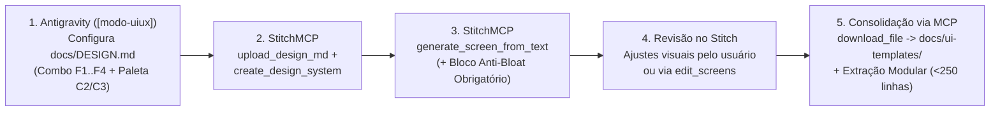

# 04-PADRAO-UIUX.md — DNA Visual Oficial, Fluxo StitchMCP e Coerência de Telas

> *Responsável por este documento:* **`[modo-uiux]`**.
> **REGRA PÉTREA:** Todas as páginas e telas do aplicativo (seja na Fase A ou na Fase B) devem obedecer estritamente aos **12 Pilares do DNA Visual** documentados aqui e em [`docs/DESIGN.md`](./DESIGN.md), partindo sempre do **Template Mestre consolidado via StitchMCP**.

---

## 1. Identificadores Oficiais do Projeto no Stitch (`StitchMCP`)

> *Preenchido e mantido automaticamente pelo `[modo-uiux]` ao sincronizar com o servidor MCP do Stitch:*

- **Stitch Project ID (`projectId`):** `{{PREENCHER_NA_FASE_0_OU_A}}`
- **Stitch Design System Asset ID (`designSystem`):** `{{PREENCHER: ex. assets/...}}`
- **Template Mestre Screen ID (`masterScreenId`):** `{{PREENCHER}}`
- **Combo de Fonte Escolhido (`F1`–`F4`):** `{{PREENCHER_NA_FASE_0: Padrão F1 (Plus Jakarta Sans)}}`
- **Paleta Escolhida (`C2` ou `C3`) & Superfície (`S1`/`S2` + `T1`–`T5`):** `{{PREENCHER_NA_FASE_0}}`
- **Arquivo Fonte do Design System:** [`docs/DESIGN.md`](./DESIGN.md)
- **Pasta de Gabaritos Consolidados (HTML/Screenshots do Stitch):** `docs/ui-templates/`

---

## 2. O Ciclo Oficial de Criação de Templates (`Antigravity` $\leftrightarrow$ `StitchMCP`)

### Regras de Ouro na Consolidação (Imutabilidade do `AppShell` e Limite de Linhas):
1. **Imutabilidade do `<AppShell>`:** O `AppShell` (Sidebar em Árvore + Topo limpo) é extraído **uma única vez** para `src/ui/design-system/AppShell`. **É estritamente proibido** que páginas em `src/ui/pages/` recriem tags `<aside>` ou sidebars próprias — elas preenchem apenas o slot central (`children`).
2. **Injeção Obrigatória do Bloco Anti-Bloat no Stitch:** Toda chamada ao `StitchMCP:generate_screen_from_text` deve anexar o bloco `STRICT ANTI-BLOAT CONSTRAINTS` da Seção 6 de [`docs/DESIGN.md`](./DESIGN.md).

---

## 3. Os 12 Pilares do DNA Visual (Regras Inegociáveis de UI/UX)

| # | Pilar | Regra Obrigatória no Stitch e no Código (`src/ui/`) | ❌ Proibido (Reprovação no Auditor) |
| :-: | :--- | :--- | :--- |
| **1** | **Densidade & Orçamento de Tela** | Foco único por tela (máx. 2 a 3 grupos visuais), muito espaço em branco (*whitespace*). | Textos explicativos óbvios ou subtítulos longos abaixo do título da página. |
| **2** | **Tipografia & "Zero Liso"** | Usar apenas os combos `F1` (`Plus Jakarta Sans`), `F2` (`Outfit + DM Sans`), `F3` (`Urbanist + Manrope`) ou `F4` (`Instrument Sans + Figtree`) com `tabular-nums`. | Fontes com ponto ou traço dentro do `0` (`JetBrains Mono`, `Fira Code`, `Space Mono`, `IBM Plex Mono`) ou `Inter`/`Roboto`. |
| **3** | **Temas & Divisões de `1px`** | Claro Técnico (`1A`) e Escuro Profundo (`1C`) estruturados por linhas contínuas de `1px`. | Itens soltos flutuando sem divisão (`1B`/`I2`) ou caixas dentro de caixas sem função (`I3`). |
| **4** | **Sidebar em Árvore (Níveis 1 e 2)** | **Tronco (Nível 1):** Ícone exclusivo + Texto. **Galhos (Nível 2):** Linha-guia vertical (`2A`) ou Trilho duplo (`2C`), sem repetir ícones nos filhos. Quando recolhida: apenas ícones dos Troncos. | Colocar o Nível 3 ("Ramos") na sidebar, repetir ícones ou usar bolinhas estilo Word (`•`). |
| **5** | **Nível 3 ("Ramos"): Abas (`5A`) vs. Vitrine (`5B`)** | **Caso `5A` (Abas):** Abas acopladas à moldura da caixa (`5A-1`) ou barra de `1px` no header (`5A-2`), título em 1 linha. **Caso `5B` (Cards-Vitrine):** Cards acionáveis (`V1`–`V4`) puros ou com linha suave divisória abaixo do título + dado claro (`#94A3B8`) na base/abaixo da seta `>`. Página do Nível 3 usa **retorno tipográfico integrado** (`Pai / Filho`, `‹ Pai | Filho` ou `Pai › Filho`). | Botão quadrado avulso com seta `[ ← ]`, seletores soltos sem integração, títulos quebrando em 2 linhas, texto colado nos botões ou cards de vitrine sem indicação de clique (`>` / `↗`). |
| **6** | **Listas, Totais (`3C`) e Detalhes (`3B`)** | Máx. 3–4 colunas; ações visíveis só no *hover* (`3A`); resumo tipográfico no topo (`3C`); painel lateral (`3B`) com `height: fit-content` (`align-items: start`). No topo de um card, o título tem destaque maior que qualquer número auxiliar à direita. | Fileiras de *KPI Cards* com badges `+12%`, número auxiliar no topo do card maior/mais forte que o título do card, ou caixa `3B` esticada com buraco vazio embaixo. |
| **7** | **Botões *Icon-Only* & Filtros (`4C`)** | Botões secundários 100% *Icon-Only* (sem texto); filtros recolhidos dentro de 1 ícone com *popover* flutuante (`4C`). | Botões cheios de texto repetitivo ou barras de filtro abertas ocupando o topo. |
| **8** | **Composição Cromática (85/12/3) & Status (`8A`/`8B`)** | Proporção **85%** superfícies/bordas `1px` da mesma família tonal + **12%** tipografia em 2 níveis + **3%** acento cirúrgico (`C2`, `C3`, `C5`, `C6`, `C7` ou paleta do projeto). Status via micro-ponto `6px` (`8A`) ou cor apenas no número (`8B`). | Cores desconexas entre fundo e card, excesso de áreas coloridas ou Tags/Pills/Badges com caixas coloridas ou borda de contorno (`8C` banido). |
| **9** | **Formulários & Edição (`9A`–`9C`)** | Edição *inline* na linha (`9C`) ou Modal compacto em grade `1px` (`9B`) para dados curtos; Card/Balão flutuante próximo ao `+`/`Editar` ou Gaveta lateral direita (`9A`) para mais dados. | Formulários gigantes espalhados pela página inteira com textos de ajuda em cada campo. |
| **10** | **Gráficos Indicativos vs. Análise** | **Indicativos (`10A–10C`):** Linha limpa, barras monocromáticas, barra de proporção horizontal. **Análise (`A1–A3`):** Título fixo no topo; ponto inspecionado em balão flutuante afastado (ou faixa inferior); em `A2`, `%` abaixo na direita em cinza claro ou balão mínimo só com `%` no *hover*; em `A3`, legenda na base/lateral + balão detalhado sem bolinhas. | Substituir o título do gráfico pelo ponto inspecionado, amontoar números cinzas acima das barras em `A2`, balão de `A2` poluído ou gráficos de pizza 3D. |
| **11** | **Largura de Tela (`11A`/`11B`) & Superfícies (`S1`/`S2`/`T1–T5`)** | Web Desktop centralizado (`max-width: 1200px` `11A`); Mobile `100%` fluido (`11B`). Cards lisos (`S1`/`S2`) sobre fundo `T1`–`T5`. | Folha quadriculada no fundo ou tabelas esticadas de ponta a ponta em monitores widescreen sem necessidade. |
| **12** | **Transições Fluidas (`M2`/`M3`) & Estados (`12C`)** | Transições curtas, fluidas e suaves (`150ms–200ms cubic-bezier(0.22, 1, 0.36, 1)`) na cor da borda/fonte/card. *Empty State* discreto de 1 linha (`12C`). | Trocas secas de borda, mudanças bruscas na seta ativa, cards "pulando" no *hover* (`translateY`) ou ilustrações gigantes de estado vazio. |

---

## 3.1 As 7 Regras Sênior de Engenharia de Experiência (Comportamento Dinâmico)

1. **Higiene Numérica em Tabelas:** Unidade (`R$`, `%`) declarada apenas no cabeçalho da coluna (`Valor (R$)`); linhas exibem apenas o número limpo (`140.000,00`). Valores zero/nulos não aplicáveis exibem traço sutil (`—`) em cinza claro. Altura de linha travada em 1 andar (*Single-Line Lock* com `ellipsis`).
2. **Anatomia Rigorosa dos Ícones:** 100% *Outline* (`stroke-width: 1.75px`, `16px`/`18px`). **Proibido** colocar caixinhas coloridas decorativas atrás de ícones informativos (só existe borda/caixa quando for um botão clicável).
3. **Escala Tipográfica Travada em 5 Degraus:** `11.5px` (legendas/rodapés `V2`/`V4`/colunas) | `13px` (corpo/listas/sidebar/inputs) | `14.5px` (títulos de cards/gráficos) | `18px` (título da página) | `22px–24px` (resumo `3C`).
4. **Regra de Upload / Dropzone:** Caixa de upload aberta só é permitida no *Empty State*; após carregar dados, converte-se em **1 botão de ícone (`↑`)** no topo.
5. **Feedback Sem Popups, Toast Efêmero Bottom-Up & Exclusão *Inline*:** Sucesso transforma o ícone acionado em `✓` por `1.5s`. Avisos de sistema usam exclusivamente **Toast compacto flutuante vindo de baixo para cima (`slide-up`) que desaparece sozinho (`3s–4s`)** — **proibido criar barras ou caixas fixas de aviso no rodapé**. Exclusão usa confirmação *inline* na linha ou `Desfazer (4s)` sem modais gigantes.
6. **Viewport Lock (`100vh`) & Sticky Headers:** O `AppShell` (Sidebar + Header + Abas `5A`) é fixo na tela; apenas o corpo da lista rola com cabeçalho de tabela *sticky*.
7. **Ergonomia Keyboard-First & Soberania do Título de Card:** *Auto-focus* imediato no 1º input ao clicar em `+` ou `🔍`; tecla `ESC` fecha qualquer balão, filtro, modal ou gaveta; `Enter` submete. No cabeçalho interno de qualquer card, o título do card tem destaque superior a qualquer métrica auxiliar lateral (`<= 13.5px`, tom neutro).

---

## 4. Catálogo de Componentes-Base (`src/ui/design-system/`)

Extraídos do **Template Mestre do Stitch** (cada arquivo `< 200 linhas`):
1. **`AppShell`:** Sidebar em Árvore (`2A` ou `2C`, recolhível para ícones, máx. Nível 2) + Container principal (`11A`/`11B`) + Botão discreto *Icon-Only* de Snapshot JSON.
2. **`PageHeader`:** Título em linha única + Navegação tipográfica integrada de Nível 3 (`Pai / Filho`, `‹ Pai | Filho` ou `Pai › Filho`, sem seta quadrada) + Resumo tipográfico opcional (`3C`) + Abas integradas (`5A-1`/`5A-2`) + Barra de ações *Icon-Only* e Popover de Filtro (`4C`).
3. **`ShowcaseGrid`:** Grade de Cards-Vitrine (`V1`–`V4`) para acesso às páginas do Nível 3 ("Ramos" Caso `5B`).
4. **`CleanDataList` & `SplitDetailPanel`:** Lista com divisões de `1px`, números em `tabular-nums` com zero liso, ações no *hover* (`3A`), edição *inline* (`9C`) e painel lateral com `height: fit-content` (`3B`).
5. **`CompactModal` / `FloatingFormCard` / `SideDrawer`:** Containers enxutos de entrada de dados (`9A`/`9B`).
6. **`ChartPrimitive`:** Variantes Indicativas (`10A–10C`) e Analíticas (`A1–A3`) com balão flutuante deslocado.
7. **`EmptyStrip` & `FeedbackToast`:** Faixa de 1 linha para estado vazio (`12C`) e Toast compacto flutuante *bottom-up* com *auto-dismiss* (`3s–4s`, zero barra fixa inferior).
8. **Extensão Condicional CAD 2D/3D & Gráficos Científicos 2D/3D (Carregada Sob Demanda):** Quando o app possuir viewports CAD 2D/3D, malhas ou gráficos de superfície 3D / isolinhas 2D, consulte obrigatoriamente [`.agents/skills/modo-uiux/references/PADRAO-CAD-3D.md`](../.agents/skills/modo-uiux/references/PADRAO-CAD-3D.md).
